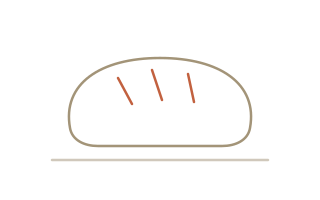

# Sourdough log

Fed the starter at 8am, one part starter to two parts flour and two parts water. It doubled by early afternoon.

Dough at 78% hydration felt slack and sticky. Next loaf: drop to 74% and fold four times instead of three.

1. Mix flour and water, rest 40 minutes
2. Add starter and salt
3. Fold every 30 minutes
4. Shape, then fridge overnight

## Notes for next time

- **Flour:** 80% white, 20% wholemeal
- **Oven:** `240°C` with the lid on, then `220°C` without
- ~~Proof on the counter~~ Proof in the fridge

> A slack dough is a *wet* dough, not a ruined one.

- [x] Feed the starter
- [ ] Buy more flour
