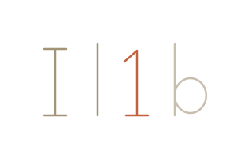

# Fonts I can read for hours



Letters with open shapes are easier for me. I want a clear difference between capital I, lowercase l and the number 1, and a b and d that are not mirror images of each other.

Extra letter spacing helps more than a bigger size. So does a little more space between words.

Never justify text. The uneven gaps between words make rivers down the page and my eyes follow the rivers instead of the sentence.

## What helps most

- **Open shapes:** wide gaps in c, e and a
- **Clear twins:** I, l and 1 must differ
- *Generous* spacing before a larger size

### My test string

```
Il1 O0 bd pq rn m
```

> If `rn` looks like `m`, the font is ==out==.

See [[Line length experiments]] for the other half.
