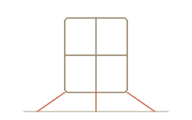

# Good light, quiet rooms

The reading room at the central library has north light and no screens. A quiet room with good light does half the work of concentrating.

Warm paper colours are easier on me than bright white. White pages glare, and the letters seem to shimmer.

## Places that work

- The **reading room**, second floor
- The café *before* nine
- ~~My desk after lunch~~

> Light from the side, never from behind the screen.

- [x] Try the Paper theme
- [ ] Try ==Sepia== in the evening
